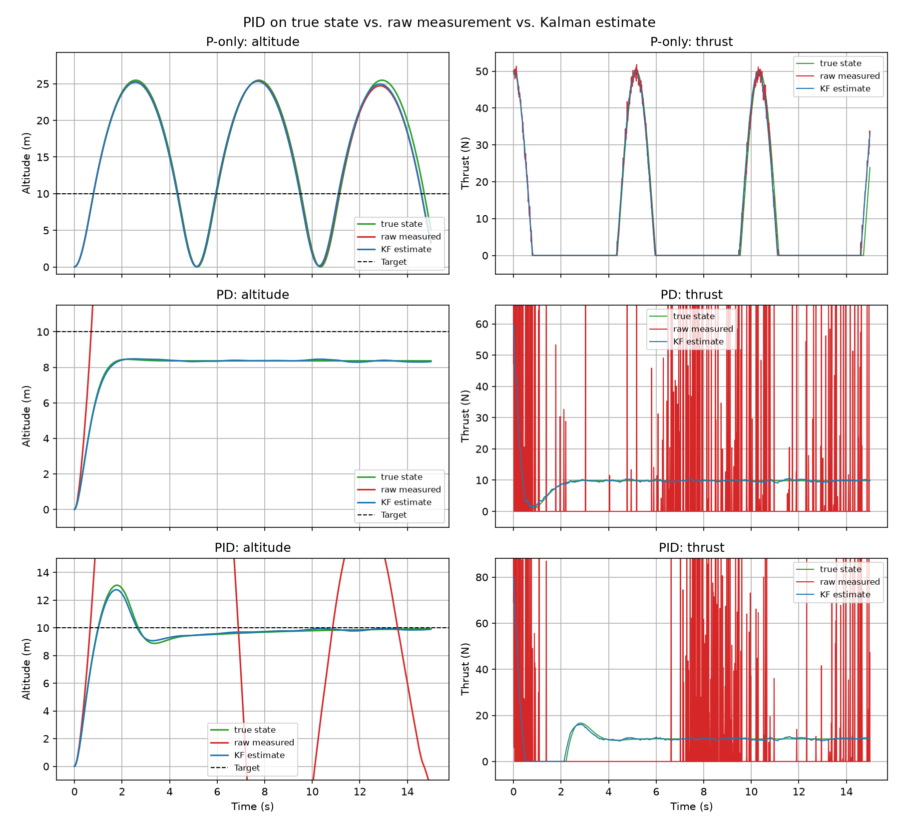

# 1D Quadrotor Altitude Control: PID, Kalman Filter, and a PPO Benchmark

This repository simulates vertical (altitude) control of a quadrotor in Python. Altitude measurements are corrupted with Gaussian noise and passed through a Kalman filter, which estimates altitude and vertical velocity. A PID controller and a reinforcement-learning policy (PPO) are then compared on the same filtered state estimate.

## Results: PID vs. PPO


The altitude simulation is wrapped as a Gymnasium environment. A PPO policy was trained at a 10 m setpoint and evaluated against a hand-tuned PID controller at the trained setpoint and at two unseen setpoints (6 m and 14 m). Metrics are averaged over 10 random seeds. Settling time is measured to a ±2% band around the setpoint.

| Setpoint | Controller | Steady-state error (m) | Overshoot | Settling time (s) |
|---|---|---|---|---|
| 10 m (trained) | PID | 0.03 | 0.9% | 1.84 |
| 10 m (trained) | PPO | 0.10 | 9.1% | 2.77 |
| 6 m (unseen) | PID | 0.03 | 1.3% | 2.03 |
| 6 m (unseen) | PPO | 0.10 | 1.1% | 8.54 |
| 14 m (unseen) | PID | 0.03 | 9.1% | 3.32 |
| 14 m (unseen) | PPO | 0.10 | 17.4% | 3.55 |

At the trained setpoint, PID outperforms PPO on all three metrics. At the unseen setpoints, PID has lower steady-state error and shorter settling time in both cases. PPO has slightly lower overshoot at 6 m, but its settling time at that setpoint is approximately four times longer than that of PID.

This result is consistent with the structure of the problem. The plant is one-dimensional, linear, and fully modelled, which are the conditions under which a well-tuned PID controller performs close to optimally. A PID controller requires no training and applies to any setpoint without modification. PPO, by contrast, learns a policy from experience at the conditions it is trained on, and its advantages are expected in systems that are nonlinear, have many degrees of freedom, or are difficult to model.

## Discussion

The difficulties a linear 1D plant can present each have a standard classical solution. Sensor noise is handled by state estimation (the Kalman filter used here). A constant disturbance is handled by integral action. A known nonlinearity, such as drag or ground effect, can be handled by feedback linearization. For this reason, reinforcement learning is not expected to outperform classical control on this task.

Problems where reinforcement learning is more appropriate include those involving unmodelled aerodynamics, contact, or transfer from simulation to hardware. A higher-dimensional simulation is planned as future work.

## Setup

* **Plant:** `envs/altitude_env.py`. The altitude dynamics are wrapped in a Gymnasium environment, so both controllers act on identical physics through `step(action)`. The quadrotor mass is 1 kg and the timestep is 0.01 s. The action is normalized thrust in [-1, 1], where 0 corresponds to hover thrust, with a maximum thrust-to-weight ratio of 2.
* **State estimation:** Both controllers observe the same Kalman-filtered estimate of altitude and velocity, so that differences in performance are attributable to the controllers alone.
* **PID:** `controllers/pid.py`, with gains Kp = 1.5, Ki = 0, Kd = 0.8. Because the action is defined relative to hover thrust, the weight of the vehicle is cancelled by feedforward. There is therefore no steady-state offset for an integral term to remove, and the controller operates as PD. This differs from `sim.py` (see below), where no feedforward is applied and the integral term is required.
* **PPO:** `train_ppo.py`. Stable-Baselines3 PPO, trained for 300,000 timesteps at the 10 m setpoint only.
* **Benchmark:** `evaluate.py`. Runs both controllers through identical episodes, computes the metrics above, and evaluates generalization at the unseen setpoints.

---

## Kalman Filter and PID Foundation

The derivative term of a PID controller acts on the rate of change of its input. When the input is a noisy measurement, differentiation amplifies the noise. The Kalman filter avoids this by estimating velocity as part of the state vector, so the derivative term can use the velocity estimate directly instead of differencing noisy position measurements.

The runs in this section use `sim.py`, in which the controller outputs absolute thrust and no gravity feedforward is applied. Each gain configuration is run three times: on the true state, on the raw measurement, and on the Kalman estimate. The measurement noise standard deviation is 0.25 m.



### Controller behaviour

**P-only (Kp = 5).** The response oscillates without decaying. The control force is proportional to displacement only, and no term opposes velocity, so the closed-loop system is equivalent to an undamped oscillator and energy is not dissipated.

**PD (Kp = 6, Kd = 4).** The derivative term adds damping, and the oscillation decays. However, the system settles at approximately 8.37 m rather than 10 m. With no feedforward, the proportional term is the only source of the steady thrust required to support the vehicle's weight, and it produces thrust only in proportion to error. A nonzero steady-state error is therefore required to hold the vehicle up.

**PID (Kp = 8, Ki = 1.5, Kd = 3.5).** The system reaches the setpoint. The integral term accumulates error over time, so its output continues to grow while any error remains. Equilibrium is reached only when the error is zero and the integral term alone supplies the thrust that balances gravity.

The benchmark in `evaluate.py` addresses the same steady-state problem by a different method: the hover thrust is supplied by feedforward, so the integral term is not needed. Integral action and feedforward are two solutions to the same problem.

On raw measurements, the PD and PID loops produce large thrust spikes and the altitude response diverges from the setpoint. On the Kalman estimate, both track the true-state response closely.

### Kalman filter operation

The filter estimates the state x = [z, v]ᵀ (altitude and vertical velocity). At each timestep it performs two operations:

1. **Prediction.** The physics model propagates the previous estimate forward one timestep using the commanded acceleration, and the estimate's uncertainty grows by the process noise.
2. **Correction.** The predicted altitude is compared with the new measurement, and the estimate is adjusted by the Kalman gain K multiplied by the difference.

The Kalman gain sets the relative weighting of the measurement and the model, based on their respective uncertainties. Large measurement noise reduces K, so the estimate relies more on the model. Large model uncertainty increases K, so the estimate relies more on the measurement. The gain is recomputed at every step.

## Reproduction

```bash
python -m venv .venv
.venv\Scripts\activate            # macOS/Linux: source .venv/bin/activate
pip install -r requirements.txt

python sim.py                     # PID and Kalman filter comparison (results/kalman_comparison.png)
python train_ppo.py               # Trains PPO and saves ppo_altitude.zip (approx. 4 min on CPU)
python evaluate.py                # Benchmark table and generalization test (results/comparison.png)
```

## Files

* `sim.py`: standalone PID and Kalman filter simulation; writes `results/kalman_comparison.png`
* `envs/altitude_env.py`: the plant as a Gymnasium environment
* `controllers/pid.py`: the PID controller as a policy object
* `train_ppo.py`: trains the PPO policy
* `evaluate.py`: PID vs. PPO benchmark and generalization test
